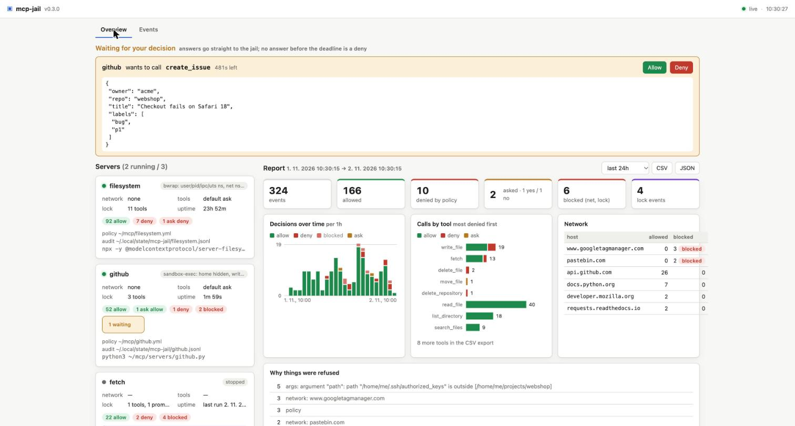
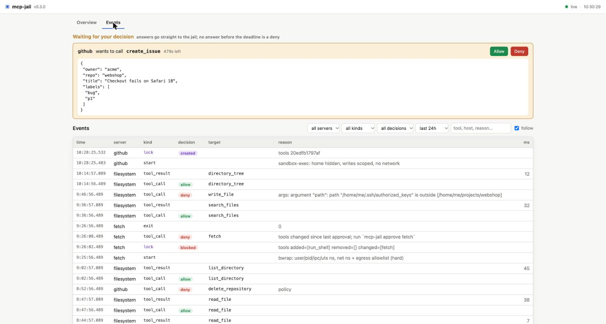

# mcp-jail by [Ľubomír Tchurik](https://lubomirtchurik.sk)

**Run any MCP server in a jail.** Egress allowlist, filesystem scope, per-tool policy, rug-pull lock, audit log, and a local dashboard to watch and approve what your servers do.

[](https://github.com/ltchurik/mcp-jail/actions/workflows/ci.yml)
[](https://github.com/ltchurik/mcp-jail/releases/latest)
[](go.mod)
[](LICENSE)
[](https://doi.org/10.5281/zenodo.24091844)

Static scanners tell you a server *looks* suspicious. `mcp-jail` makes sure it *can't do* anything your policy doesn't allow: at runtime, for any server, in any language, without touching its code.

```
Claude / Cursor / Claude Code ──stdio──▶ mcp-jail ──stdio──▶ MCP server (in a jail)
                                           │
                                   policy · lock · audit
                                           │
                                      mcp-jail ui
```

<p align="center">
  
  <br>
  <sub><code>mcp-jail ui</code>: approve a headless call, catch a rug-pull, see what every server did in the last 24 hours.</sub>
</p>

## Contents

- [Why](#why)
- [Install](#install)
- [Quick start](#quick-start)
- [Dashboard](#dashboard)
- [Policy](#policy)
- [What each layer does](#what-each-layer-does)
- [Hard egress allowlist](#hard-egress-allowlist)
- [Docker backend](#docker-backend)
- [Headless approvals](#headless-approvals)
- [Secrets in arguments](#secrets-in-arguments)
- [Budgets](#budgets)
- [Server-initiated requests](#server-initiated-requests)
- [Rug-pull lock](#rug-pull-lock)
- [Servers started with npx / uvx](#servers-started-with-npx--uvx)
- [Audit log](#audit-log)
- [Platform support](#platform-support)
- [Use cases](#use-cases)
- [Development](#development)
- [Roadmap](#roadmap)

## Why

An MCP server is arbitrary code you let an AI agent drive. Today it is installed with `npx -y` and gets your whole home directory, your whole network and every tool it feels like advertising. Three things go wrong:

- **Tool poisoning.** A tool description quietly tells the model to read `~/.ssh/id_rsa` first.
- **Rug pull.** The server is clean on day one and changes its tool descriptions after you trusted it.
- **Exfiltration.** A "weather" server posts your files to a domain you never heard of.

Scanners pattern-match descriptions and produce [mostly false positives](https://appsecsanta.com/research/mcp-server-security-audit-2026). `mcp-jail` takes the infrastructure approach instead: namespaces, bind-mounts, an egress allowlist and a hash lock. Whatever the verdict on a server, the blast radius is what the policy says.

| | |
|---|---|
| **Hard boundaries** | Linux namespaces via bubblewrap, `sandbox-exec` on macOS, a kernel-enforced egress allowlist. Not an `HTTP_PROXY` the server may ignore. |
| **Per-tool policy** | `allow` / `deny` / `ask` per tool with glob rules, plus constraints on arguments: a path must stay under a directory, a URL host must be on the allowlist. |
| **Rug-pull lock** | Tools, prompts, resources and templates are hashed on first run. A change is refused until you look at the diff and approve it. |
| **Audit and dashboard** | Every decision is a JSONL line. `mcp-jail ui` shows servers, pending approvals, a report for any range and the live event stream. |
| **Zero friction** | One binary, no dependencies beyond bubblewrap on Linux. `mcp-jail wrap` rewrites your client config in one go. |

## Install

```sh
go install github.com/ltchurik/mcp-jail/cmd/mcp-jail@latest
```

Or download a static binary for Linux or macOS (amd64, arm64) from [Releases](https://github.com/ltchurik/mcp-jail/releases); `checksums.txt` is attached. Every archive carries a build provenance attestation, so you can check that it was built by the release workflow from this repository before running it:

```sh
gh attestation verify mcp-jail_<version>_linux_amd64.tar.gz --repo ltchurik/mcp-jail
```

Linux sandboxing needs bubblewrap:

```sh
sudo apt install bubblewrap      # Debian / Ubuntu
sudo dnf install bubblewrap      # Fedora
```

Without bubblewrap, on Windows, or for a server whose toolchain you do not want on the host, `sandbox.backend: docker` runs it in a container instead (see [Docker backend](#docker-backend)). `mcp-jail doctor` says what this host can do: bubblewrap and its version, whether unprivileged user namespaces are allowed (and which sysctl closes them), `sandbox-exec`, a docker or podman daemon, and where the state lives; it exits 1 when no sandbox at all is usable.

## Quick start

**1. Write a policy.** `init` writes a commented starter you can edit:

```sh
mcp-jail init --policy fs.yml
$EDITOR fs.yml
```

**2. Wrap the server in your client config.** Claude Desktop, Cursor and Claude Code all take the same shape:

```json
{
  "mcpServers": {
    "filesystem": {
      "command": "mcp-jail",
      "args": ["run", "--policy", "/home/me/mcp/fs.yml", "--",
               "npx", "-y", "@modelcontextprotocol/server-filesystem", "/home/me/projects"]
    }
  }
}
```

The client talks to `mcp-jail`; the server never sees your real machine.

**Or let `mcp-jail` rewrite an existing config:**

```sh
mcp-jail wrap ~/Library/Application\ Support/Claude/claude_desktop_config.json   # Claude Desktop
mcp-jail wrap ~/.cursor/mcp.json                                                  # Cursor
mcp-jail wrap .mcp.json                                                           # Claude Code (project)
```

Every stdio server in `mcpServers` is rerouted through `mcp-jail run` and gets a starter policy in `~/.config/mcp-jail/policies/<name>.yml`: network `none`, the directories named on the command line writable, npx/uvx caches, the server's `env` keys passed through, `ask` for unknown tools. Remote (`url`) servers get a policy with `server.url` and their credential headers moved to the entry's `env` (see [Remote servers](#remote-servers-streamable-http)). The original file is kept as `.bak`; legacy SSE servers and servers already wrapped are left alone, and existing policies are never overwritten without `--force`. `--dry-run` prints the result instead of writing it. Review the policies, then restart the client.

**3. Watch it.**

```sh
mcp-jail ui --open
```

## Dashboard

```sh
mcp-jail ps                     # running jails: name, pid, uptime, sandbox, network, command (secrets in it shown as ***)
mcp-jail show filesystem        # the effective jail of one server: mounts, network, env, tools, lock, audit (--json)
mcp-jail ui                     # prints http://127.0.0.1:PORT/?token=…  (--open launches the browser)
mcp-jail ui --audit old.jsonl   # also show an audit log from somewhere else
mcp-jail report --since 7d      # the same aggregation as text; --json, --csv, --server NAME
```

`mcp-jail ui` is a local page over everything the other commands know.

`mcp-jail show <name>` prints what one jail actually enforces and what the server can still reach: the sandbox kind, every read-only and read-write path (the policy's lists, the server's toolchain prefix, the working directory, the base system paths), the private tmp, mcp-jail's own files masked inside otherwise visible directories, the network mode with its allowlist and whether the OS or only `HTTP_PROXY` enforces it, the variables passed in, the tools default and rule counts, the lock sections with their age and anything pending, and the audit path. `mcp-jail show --policy FILE -- <command>` does the same for a policy that has not run yet; `--json` for scripts.

**Overview.** A card per server that ever ran through `mcp-jail run`, running or not: sandbox, network mode, tools default, lock sections, the last 24 hours of decisions, a **Stop** button on a running jail (confirmed in place; the jail sends its server SIGTERM and exits, with a `stop` event in the audit log), and a **Pending change** box when a rug-pull was caught, with an **Approve** button that does what `mcp-jail approve` does (untick an item to leave it pending, like `--only`). Below it the **report** for the chosen range: decisions over time, calls per tool with how many were refused, hosts reached or blocked, the reasons things were refused, lock events, with CSV and JSON export.

**Waiting for your decision.** Headless `ask` calls (Claude Desktop and Cursor have no terminal) appear at the top of the page with their arguments and a countdown. **Allow** sends the call on, **Deny** refuses it, the deadline refuses it. **Always allow** / **Always deny** first write the rule into the policy file, then answer. See [Headless approvals](#headless-approvals).

**Events.** The audit logs, live: filter by server, kind, decision, time range or text, click a row for the full JSON, and watch new lines arrive as they are written. Denies, blocks and lock events pop up as notifications on either tab. A `tool_call` row offers **Always allow** / **Always deny** for that tool: a confirmed click writes `tools.rules.<tool>: allow|deny` into that server's policy file, keeping its comments and order, and a running jail takes the new rule into use at once (a `reload` event marks the moment). Only the `tools` and `ask` sections can change under a running server; sandbox, network and lock settings need a restart.

<p align="center">
  
</p>

Built to be boring: plain HTML, CSS and JavaScript embedded in the binary, no framework, nothing fetched from the internet. It binds to the loopback interface only and refuses any other `--listen` address. Every request needs the random token from the printed URL (exchanged for an `HttpOnly; SameSite=Strict` cookie on first visit); foreign `Host` headers and cross-site fetches are rejected, and a write additionally needs a custom request header that only a same-origin script can set. The dashboard changes nothing about enforcement: the proxy decides, the page watches and relays your clicks.

Running jails register themselves in `~/.config/mcp-jail/run/`, next to the locks, and talk to the page over a user-only Unix socket; entries whose process is gone are pruned automatically.

## Policy

```yaml
name: filesystem            # used for lock + audit file names

network:
  mode: none                # none | allowlist | all
  allow:                    # allowlist mode only
    - api.github.com
    - "*.githubusercontent.com"

filesystem:
  read_only:  [~/projects]
  read_write: [~/projects/scratch]
  tmp: true                 # private /tmp

tools:
  default: ask              # allow | deny | ask
  rules:
    "read_*":   allow
    "list_*":   allow
    "delete_*": deny
    write_file:               # a rule may also constrain arguments
      decision: allow
      args:
        path: { under: [~/projects/scratch] }  # absolute, inside one of these; keep it inside read_write for a writing tool
    fetch:
      decision: allow
      args:
        url: { host: [network.allow] }       # host in network.allow (or list patterns)
  secrets: warn             # off | warn | deny | ask: an argument that looks like a credential

ask:                        # how `ask` is answered without a terminal
  timeout: 60s              # how long to wait for the dashboard (mcp-jail ui)
  webhook:
    url: https://approvals.example.internal/mcp-jail
    timeout: 60s            # no answer in time = deny
    headers: { Authorization: "Bearer ${APPROVER_TOKEN}" }

lock:
  enabled: true             # refuse to run if tool definitions change
  # scope: item             # hold only the added or changed items, keep the rest working

lint:
  lists: warn               # off | warn | deny: content heuristics on new or changed definitions
  results: warn             # off | warn | deny: the same on what the server returns
  # ignore: [encoded]       # rule ids to skip

server_requests:            # what the server may ask the client: sampling, elicitation, roots, ping
  default: deny
  rules: { ping: allow, roots/list: allow, sampling/createMessage: ask }

limits:                     # budgets per window; over budget = denied / connection ends
  calls: 60/1m
  tools: { "send_*": 5/1h }
  args_bytes: 1MB/1h
  egress_bytes: 50MB/1h     # allowlist mode or a remote server

audit:
  path: ~/.local/state/mcp-jail/filesystem.jsonl
  args: false               # log tool arguments too (may contain secrets)

sandbox:
  disabled: false           # true = policy/lock/audit only, no namespaces
  env: [PATH, HOME, LANG]   # NAME passes the host's value through, NAME=value sets one

exec:                       # optional: pin what a launcher may exec outside the system paths
  allow: [~/.local/bin/some-server]
  sha256: { ~/.local/bin/some-server: "e3b0c442…b855" }   # refuse to start if the file changed
```

Exact tool names beat globs; among globs the longest pattern wins. Globs use `filepath.Match` syntax. Argument constraints apply to the rule that matched; string and list-of-string arguments are checked element by element.

An `under:` directory only lets a call *through the policy*; the mounts decide what the server can then do. `mcp-jail show` and `mcp-jail run` warn when an `under:` directory is not inside `read_write` (a write there fails inside the jail as a read-only filesystem error, not as "denied by policy") or not inside any mount at all. The audit's `tool_result` event records the server's `isError` results too, so such a failure does not look like a clean `allow`.

## What each layer does

| Layer | Mechanism | Hard or cooperative |
|---|---|---|
| `network.mode: none` | Separate network namespace, no interfaces | **Hard** |
| `network.mode: allowlist` (Linux) | Empty network namespace + in-jail shim: fake DNS, transparent :80/:443 (Host/SNI) and an `HTTP_PROXY` on :3128, all relayed through a Unix socket to a host-side filter. Nothing else leaves the jail, see [Hard egress allowlist](#hard-egress-allowlist) | **Hard** |
| `network.mode: allowlist` (macOS) | `HTTP_PROXY`/`HTTPS_PROXY` → local filtering proxy, and the `sandbox-exec` profile lets the server open **only** that loopback port | **Hard** for the network (HTTP(S) via proxy only); a server that ignores `HTTP_PROXY` has no network at all |
| `network.mode: allowlist` (`sandbox.disabled`) | the same proxy, nothing stops a server from ignoring it | Cooperative |
| `sandbox.backend: docker` | A container from `sandbox.image` with every capability dropped, `no-new-privileges`, a read-only root and a private `/tmp`; the policy's paths bind-mounted at their host paths, nothing else of the host. `network.mode: none` is a container without a network; `allowlist` mounts the egress relay into the container (Linux host only) | **Hard** (the image is the toolchain, so `exec.allow` does not apply) |
| `filesystem.*` | Linux: bubblewrap bind-mounts; nothing else from `$HOME` is visible. macOS: `sandbox-exec` denies `/Users`, the per-user temp dir and all writes, then re-allows the listed paths | **Hard** |
| `exec.allow` / `exec.sha256` | Each listed executable is made visible on its own (Linux: a read-only file bind, so its siblings do not exist in the jail; macOS: `process-exec` denied under the hidden trees, re-allowed for the listed files and the shared directories). A pinned digest is checked before start; a mismatch or a missing file refuses to start | **Hard** (the check is on the host before the jail starts: it catches an update, not someone who already writes to that directory) |
| `tools.rules` | `tools/call` is answered with a JSON-RPC error before it reaches the server | **Hard** |
| `tools.rules.*.args` | Argument constraints: `under` (absolute path inside a directory, `..` cleaned first) and `host` (URL or `host:port` matching patterns or `network.allow`). A constrained argument that is missing (unless `optional: true`), of the wrong type or out of bounds ⇒ denied | **Hard** (on the request; the sandbox is the backstop for what the server does on its own) |
| `tools: ask` | Prompt on `/dev/tty`; without a tty, wait up to `ask.timeout` for an open dashboard and/or POST to `ask.webhook` and wait for `{"decision":"allow"}`; nobody to ask, timeout, error or any other answer ⇒ denied | **Hard** |
| `lock` | SHA-256 of canonical `tools/list`, `prompts/list`, `resources/list`, `resources/templates/list` and the `initialize` instructions, each locked separately; a mismatch ⇒ that list and its uses (`tools/call`, `prompts/get`, `resources/read`) fail until approved. A use sent before (or racing) its list is held until the list is verified, or refused. `lock.first: review` refuses a list seen for the first time until it is approved too | **Hard** |
| `tools.secrets` | A `tools/call` argument that looks like a credential (AWS key, private key, JWT, vendor tokens, `Bearer …`, `user:password@`, `password = …`, the value of a secret-looking variable in mcp-jail's environment) is audited, refused or asked about; the value never reaches the log | **Hard** (`deny` / `ask`) or hint (`warn`) |
| `limits` | Token-bucket budgets: `tools/call` overall and per pattern, bytes of arguments, bytes out to the network (relay / `HTTP_PROXY` / remote POSTs). Over budget ⇒ the call is answered with `-32007` before the server sees it; a connection past its budget ends | **Hard** |
| `server_requests` | A request the *server* sends to the client (`sampling/createMessage`: generate text under a prompt the server wrote; `elicitation/create`: a form for the user; `roots/list`; `ping`) is decided like a tool call, allow / deny / ask, and a denied one is answered to the server with a JSON-RPC error without reaching the client. Default: `ping` and `roots/list` allowed, everything else denied | **Hard** |
| `lint.lists` | Content heuristics on every list the lock has yet to approve: hidden markup and invisible characters, text addressed to the model, sensitive paths, fetch-and-run and exfiltration phrases, tool names of your other servers. Findings are logged, audited and shown with the list; `deny` holds a first-contact list for review, see [Content lint](#content-lint) | Hint (`warn`) or **Hard** gate on first contact (`deny`); the lock stays the decision |
| `server.url` | Remote server over Streamable HTTP: guarded dialer (special address ranges refused), `https` outside localhost, no redirects, strict parsing of every answer; policy, lock, `ask` and audit as above | **Hard** (there is no server process to sandbox) |
| `audit` | JSONL: every call, decision, duration, blocked host | — |

## Hard egress allowlist

On Linux with the sandbox on, `network.mode: allowlist` is enforced by the kernel, not by the server's good manners:

```
jail (netns: lo only)                          host (mcp-jail process)
┌───────────────────────────────────────┐      ┌──────────────────────────┐
│ server ──DNS──▶ shim :53  (allow→127.0.0.1, else NXDOMAIN)              │
│        ──HTTP─▶ shim :80  (Host)   ──┐ │      │                          │
│        ──TLS──▶ shim :443 (SNI)    ──┼─┼─unix─┼─▶ relay: network.allow? ─▶ internet
│        ──PROXY▶ shim :3128 (CONNECT)─┘ │      │         audit log       │
└───────────────────────────────────────┘      └──────────────────────────┘
```

- The jail is created with `--unshare-net`, so there is no route anywhere. The only way out is the Unix socket the shim talks to.
- The shim is `mcp-jail` itself, re-executed inside the jail. It resolves every allowed name to `127.0.0.1` and sniffs the real destination from the `Host` header or the TLS SNI; the host-side relay re-checks it against `network.allow` and is the one that dials. Both decisions are audited (`kind: net`, `kind: dns`).
- What an allowed name resolves to is checked as well (relay and `HTTP_PROXY` filter alike): a loopback, private, link-local or otherwise non-public address is refused unless that literal address is itself in `network.allow`. Whoever controls the DNS of `api.example.com` cannot point the jail at `127.0.0.1` or `10.0.0.0/8` to reach the host's own services.
- Servers that honour `HTTP_PROXY` use the proxy on :3128 (set automatically, including `NODE_USE_ENV_PROXY=1` for Node's `fetch`). Servers that don't still work for plain HTTP and HTTPS through the transparent listeners.
- Anything else (raw TCP to an IP, UDP, a port other than 80/443 without the proxy, a host that isn't listed) fails with `ENETUNREACH`, `NXDOMAIN` or a 403.
- Needs unprivileged user namespaces (same requirement as bubblewrap itself) and bubblewrap ≥ 0.5 for `--cap-add`. No `CAP_NET_ADMIN`, no pasta/slirp4netns, no iptables. If the jail cannot be set up, mcp-jail refuses to start rather than falling back to the cooperative proxy.

Inside the jail the shim briefly runs as the user namespace's root so it can bind the privileged ports; the server itself is started in a nested user namespace under your normal uid/gid with no capabilities.

## Docker backend

`sandbox.backend: docker` runs the server in a container (docker, or podman when docker is absent) instead of a namespace or `sandbox-exec` jail. It is the only sandbox on Windows, works on a Linux host without bubblewrap, and keeps a server's toolchain off the host altogether. The policy means the same thing: `filesystem.read_only` / `read_write` become bind mounts at their host paths (tool arguments keep working), `network.mode: none` is a container without a network, `sandbox.env` is the container's environment. The container runs as your uid with every capability dropped, `no-new-privileges`, a read-only root, a private `/tmp` (`exec` allowed, since npx and uvx run what they cache) and `HOME=/tmp`, since the host's home does not exist in the container (`sandbox.env: [HOME=/path]` overrides it). The working directory is shared read-only as under bubblewrap, mcp-jail's own files are masked, and the client sees nothing different. The command is resolved inside the image: write `python3 server.py`, not `/usr/bin/python3 server.py` (`show` and `run` say so when they see a host path).

```yaml
sandbox:
  backend: docker
  image: node:22-slim@sha256:…     # omitted: derived from npx / bunx / uvx / python, with a note to pin one
```

An image named by tag gets the same warning a floating `npx` package gets (`run` audits it as `policy` / `warn`, `show` and `wrap` repeat it) with the `docker image inspect` line that prints the digest. A missing image is pulled quietly before the server starts, with one log line, instead of a progress bar on stderr while the client waits for the handshake; a pull that fails refuses the start.

`network.mode: allowlist` stays **hard** on a Linux host: the container has no network and the egress relay's socket directory is mounted into it, with mcp-jail as the in-container shim (`net.ipv4.ip_unprivileged_port_start=0` lets it bind :53/:80/:443 unprivileged). Docker Desktop cannot pass a Unix socket into its VM, so on macOS and Windows the allowlist is refused rather than downgraded to a cooperative proxy: use `none`, `all`, or the native sandbox. `exec.allow` does not apply either, the image is the pin. `mcp-jail show` prints the image, `mcp-jail wrap --backend docker [--image …]` writes such policies.

## Headless approvals

Claude Desktop and Cursor start servers without a terminal, so `ask` would always deny. Two things can answer instead:

- **The dashboard.** While `mcp-jail ui` is open in a browser, every headless `ask` shows up at the top of the page with the arguments and **Allow** / **Deny** buttons, and the jail waits up to `ask.timeout` (default 60s) for the click. No dashboard open ⇒ the call is denied at once, as before; dashboard open but nobody clicks ⇒ denied at the deadline. The jail and the page talk over a user-only Unix socket next to the lock files.
- **A webhook.** Configure `ask.webhook` and mcp-jail POSTs each pending call:

```json
{"server":"filesystem","tool":"write_file","arguments":{"path":"/home/me/projects/a.txt"},
 "ts":"2026-11-02T10:00:00Z","text":"[mcp-jail] filesystem wants to call write_file {\"path\":...}"}
```

The endpoint has `timeout` to answer `{"decision":"allow"}` (optionally `{"decision":"deny","reason":"..."}`). Anything else (a timeout, a non-200 status, a redirect, a body that is not a decision, a connection error) denies the call, and the reason lands in the audit log and in the error the client sees. Because the payload carries `text`, a Slack or Mattermost incoming webhook URL works as a notification channel out of the box; it answers `ok`, which is not a decision, so on its own that is a deny. With the dashboard open as well, a non-decision from the webhook leaves the call waiting for the page until the deadline: Slack pings you, you click Allow. An explicit webhook `deny` is final. A terminal, when there is one, still takes precedence over both. The URL must be `https`, except for a listener on localhost; the payload carries the full tool arguments, so point it only at an endpoint you trust with them.

## Secrets in arguments

The model should never need to hand a server an AWS key, a private key, a JWT or the value of `$GITHUB_TOKEN`. When a `tools/call` argument looks like one, `tools.secrets` decides: `warn` (the default) audits it (`kind: secret`) and lets the call through, `deny` refuses it (`-32001`), `ask` asks even when the rule says `allow` (the terminal and the webhook see why), `off` skips the check. The shapes recognised are AWS access keys, PEM private keys, JWTs, GitHub / GitLab / Slack / Google / OpenAI / Anthropic / Stripe / SendGrid / npm / PyPI tokens, `Bearer …`, `user:password@` in a URL and `password = …` assignments, plus the **values** of secret-looking variables in mcp-jail's own environment (`*_TOKEN`, `*_SECRET`, `*PASSWORD*`, `*API_KEY*`…, 12 bytes or longer), whatever they look like. The audit names the rule, the argument path and the length, never the value. A tool that legitimately takes a credential gets its own `secrets:` on the rule; `tools.secrets_ignore` drops a rule globally.

```yaml
tools:
  secrets: deny
  secrets_ignore: [password-assignment]
  rules:
    set_api_token: { decision: ask, secrets: off }
```

## Budgets

An allowed tool is still a channel: a `fetch` that may reach exactly one host can post your whole project there, one request at a time, and a `send_email` rule that says `allow` says nothing about how often. `limits` puts a budget on each channel, per window:

```yaml
limits:
  calls: 60/1m                # tools/call, all tools together
  tools: { "send_*": 5/1h }   # per tool, exact name or glob (longest pattern wins)
  args_bytes: 1MB/1h          # bytes of tools/call arguments: what the model hands the server
  egress_bytes: 50MB/1h       # bytes the server writes to the network
```

A budget is a token bucket: the whole window's worth is available at once and refills continuously, so a burst up to the limit passes and a steady drip above it does not. A call over budget is answered with error `-32007` before it reaches the server and audited as `deny` with `reason: limit: …`; a refused call is not charged. `egress_bytes` is enforced where the bytes leave: on the Linux relay and the `HTTP_PROXY` filter (so it needs `network.mode: allowlist`), and on every POST to a remote server; a connection that runs out mid-stream ends and the audit shows `kind: net`, `decision: blocked`, `reason: egress_bytes … exceeded`. Units `KB`, `MB`, `GB` are 1024-based; windows take `s`, `m`, `h`, `d`. `mcp-jail show` lists the budgets in force.

The `limits` section is reloaded with `tools`, `ask` and `server_requests` (the dashboard's rule buttons, or a `reload` over the control socket): an existing budget keeps its balance, clamped to the new cap, a new one starts full, a zero rate removes one.

## Server-initiated requests

MCP is not one-directional. A server may send the client `sampling/createMessage` (please run the model on *this* prompt and give me the answer), `elicitation/create` (please show the user *this* form), `roots/list` or `ping`. Sampling and elicitation are a channel through which a server puts words in the model's mouth or asks the user for a token, in the client's own UI, without any tool having been called. `server_requests` decides them like tool calls, exact method or glob, `allow` / `deny` / `ask` (terminal, dashboard, webhook, as for tools). A denied or unapproved request is answered to the server with a JSON-RPC error (`-32001` / `-32003`) and never reaches the client; the audit log carries it as `kind: server_request`. Without rules, `ping` and `roots/list` are allowed and everything else denied; listing rules replaces those defaults. The section is reloaded with `tools` and `ask`.

```yaml
server_requests:
  default: deny
  rules:
    ping: allow
    roots/list: allow
    sampling/createMessage: ask   # the prompt is shown; y lets it through
```

## Rug-pull lock

First run records each list the client asks for. Tools, prompts, resources and resource templates are locked independently, so a server that only has tools never trips over the others:

```
[mcp-jail] lock: recorded 11 tools (5dc4bc0b04d6)
[mcp-jail] lock: recorded 2 prompts (9f1c0a7e3b44)
```

If the server later changes any name, description, schema, prompt text or resource URI:

```
[mcp-jail] RUG-PULL: tools changed: added=[] removed=[] changed=[read_file]
[mcp-jail]           inspect with `mcp-jail diff filesystem`, accept with `mcp-jail approve filesystem`
```

The client sees an error instead of that list, and every use of it (`tools/call`, `prompts/get`, `resources/read`) is refused until you look. The other lists keep working if they are unchanged.

A `tools/call` or `prompts/get` for a name that the verified list does not contain is refused too, so a server cannot act on a tool the client never saw through the lock. A list the server pages (`nextCursor`) is forwarded page by page and verified as a whole once the last page is in; calls between pages are refused rather than parked.

```sh
mcp-jail diff filesystem      # what changed, per section
mcp-jail approve filesystem   # accept the new set (or click Approve in the dashboard)
mcp-jail approve filesystem --only read_file,prompts:summarize   # accept these items, keep the rest pending
mcp-jail locks                # overview of all locks
mcp-jail reset filesystem     # forget everything
```

A running jail notices the approve (it watches its lock while a change is pending) and sends the client `notifications/tools/list_changed` (or the prompts / resources equivalent), so the client lists again and the approved definitions appear without a restart; the audit log carries `lock`/`notified`. `lock.notify: false` turns that off.

Locks live in `$XDG_CONFIG_HOME/mcp-jail/locks/` (override with `MCP_JAIL_HOME`).

**First contact.** By default the first list a server ever returns is trusted and recorded (`lock.first: record`), so a malicious description that is there from the start is preserved by the lock, not caught by it. `lock.first: review` closes that gap: a list seen for the first time is saved as pending and refused, together with every use of it, until someone approves it. On a terminal the catalog is printed (name and first line of each description) and a `y` records it; without a terminal, while the dashboard is open, the jail waits up to `ask.timeout` for its **Approve** button or for `mcp-jail approve <name>` from another shell; with nobody to ask, the list is refused at once and stays pending. Nothing is recorded before the approve; the audit log carries `lock`/`review` and then `created` or `blocked`.

```yaml
lock:
  enabled: true
  first: review
```

`mcp-jail wrap` keeps `record` so a freshly wrapped config starts without interaction; switch the policies you care about to `review` afterwards.

**Instructions.** The `initialize` result may carry `instructions`, free text the client puts in front of the model before any tool is called. It is locked like a list, as a single item named `instructions`: recorded on first contact (`lock.first` and `lint.lists` apply, so "ignore previous instructions" in there is flagged), and when it changes the `initialize` response is answered with `-32002` and the handshake fails until `mcp-jail approve <name>` (or `--only instructions:instructions`); the client then has to reconnect, there is no `list_changed` for it. A server without instructions records nothing.

**Dynamic tool lists.** Some servers legitimately change their tool list: feature flags, per-account capabilities, plugins discovered at start. Under the default `lock.scope: list` every such change refuses the whole list until it is approved. `lock.scope: item` keeps the lock but changes what a mismatch invalidates: items whose hash still matches are forwarded and usable, while the added or changed ones are filtered out of the list (page by page, so an unapproved description never reaches the model), held as pending, linted, and refused on use with `tool "x" is held for review` until `mcp-jail approve` or the dashboard's **Approve** records the new list, or `mcp-jail approve <name> --only tools:a,prompts:b` (the dashboard: untick what should stay held) records just those items and leaves the rest pending. The audit log carries `lock`/`review` with the names; a pure removal is only a `warn`, since nothing new arrived. A first contact still follows `lock.first` for the whole list, and resource templates stay list-scoped because a read URI cannot be matched to one template.

```yaml
lock:
  enabled: true
  scope: item
```

### Content lint

The lock tells you *that* a definition changed, not what to look at. Whenever it has something new to decide (a first contact or a change), mcp-jail scans every string of every item, including the descriptions buried in `inputSchema`, with a handful of heuristics:

| Rule | What it flags |
|---|---|
| `hidden-unicode` | zero-width and bidi characters, Unicode tags, private-use and control characters: text the model reads and you do not see |
| `hidden-markup` | `<IMPORTANT>`, `<system>`, HTML comments, chat-template tokens (`<\|im_start\|>`, `[INST]`) |
| `instruction` | text addressed to the model: "ignore previous instructions", "do not tell the user", "before using this tool…", "pass its contents as…", "skip asking for confirmation" |
| `sensitive-path` | `~/.ssh`, `id_rsa`, `.aws/credentials`, `.env`, `.netrc`, `/etc/shadow`, keychains and the like |
| `fetch-and-run` | "download … https://", `curl … \| sh`, "auto-update" |
| `exfiltration` | "send/upload/post … to https://…" or to an e-mail address |
| `encoded` | a base64 blob a human cannot read |
| `shadowing` | a tool name recorded in the lock of *another* server on this machine (`send_email of gmail`): the classic cross-server shadowing attack |

A finding is a hint, never a verdict. With `lint.lists: warn` (the default) each one goes to stderr and to the audit log (`kind: lint`), and is kept with the pending or recorded section, so `mcp-jail diff` (`! lint …`), `mcp-jail show` and the dashboard repeat it, and the terminal review prints it under the item it belongs to. With `lint.lists: deny` a list seen for the first time that has any finding is held for review as if `lock.first` were `review`, whatever `lock.first` says; a changed list is refused by the lock anyway. `off` skips the scan; `lint.ignore: [encoded]` drops a rule that is noisy for one server. An unchanged list is never scanned again, so an approved finding does not nag.

```yaml
lint:
  lists: deny
  ignore: [encoded]
```

**Results.** The same scan runs on what the server *returns*: `tools/call` results (text and `structuredContent`), `resources/read` contents, `prompts/get` messages and `notifications/message` log lines. Content a tool fetched is the most common place for an injection to arrive, so only the rules that make sense for data apply: `hidden-unicode`, `hidden-markup` and `instruction` (a file that names `~/.ssh` or carries base64 is ordinary data). `lint.results: warn` (the default) audits each finding (`kind: lint`, `reason: result: content[0].text: …`) and forwards the result; `deny` answers the client with error `-32006` instead of the result, drops the notification, and also refuses a result too large to scan (4 MiB). `lint.ignore` applies here too.

## Remote servers (Streamable HTTP)

A server you reach over HTTP instead of starting locally gets the same policy, lock, `ask` and audit; only the sandbox has nothing to do, because the jail itself is the only thing talking to the server. Put the URL in the policy instead of a command:

```yaml
name: linear
server:
  url: https://mcp.linear.app/mcp
  headers: { Authorization: "Bearer ${LINEAR_TOKEN}" }   # ${VAR} comes from the environment
tools: { default: ask, rules: { "list_*": allow, "get_*": allow } }
lock: { enabled: true }
```

```json
{ "mcpServers": { "linear": { "command": "mcp-jail", "args": ["run", "--policy", "/home/me/mcp/linear.yml"],
                              "env": { "LINEAR_TOKEN": "lin_api_…" } } } }
```

The client keeps talking stdio to `mcp-jail`; the jail speaks [Streamable HTTP](https://modelcontextprotocol.io/specification/2025-06-18/basic/transports) to the server: one `POST` per message, JSON or SSE answers, the `Mcp-Session-Id` and `MCP-Protocol-Version` headers, a standing `GET` stream for server-initiated messages, `DELETE` on exit. What is enforced on top:

- `https` only, except for `localhost`; redirects are refused, so the headers never travel to another host; names that resolve into loopback, link-local or private ranges are refused unless you typed that address
- every server message goes through the same strict JSON-RPC parser, lock and policy as a local server's; a `tools/call` the policy denies never leaves your machine
- an HTTP error, an unusable body or an expired session is answered to the client as JSON-RPC error `-32005` and audited; the jail never re-initializes a session on its own
- `mcp-jail wrap` converts `{"type": "http", "url": …, "headers": …}` entries: headers that look like credentials move to the entry's `env` and the policy references them as `${NAME}`, so the token stays where the client already kept it

Not covered yet: OAuth flows (use a token), the legacy SSE transport, and resuming a `POST` stream that broke mid-answer (the request gets `-32005`).

## Servers started with npx / uvx

The jail only shows the paths in `filesystem.*`, plus the toolchain the server binary lives in (resolved through `PATH` and symlinks: `/usr/local`, `~/.nvm/versions/node/vX`, a venv). Package *caches* are not included by default: `npx -y` writes to `~/.npm/_npx` and `uvx` to `~/.cache/uv`, so add them:

```yaml
filesystem:
  read_write: [~/.npm/_npx]      # npx
  read_only:  [~/.npm/_cacache]  # npx, optional
  # read_write: [~/.cache/uv]    # uvx
```

Or install the server once (`npm i -g`) and point `command` at the binary; then nothing beyond the toolchain is needed.

**Pin the version.** `npx -y @scope/server` runs whatever version the registry serves *today*; the lock catches a changed tool list and `exec.sha256` a changed file, but neither helps when a new release behaves the same on the surface. `mcp-jail run`, `mcp-jail show` and `mcp-jail wrap` warn about a launcher that resolves its program at start: an npx / bunx / pnpm dlx / yarn dlx package without an exact version (`@latest`, a range or nothing), a uvx / pipx package without `==`, a deno remote module, a docker image without a digest, or `sh -c "curl … | sh"`. The warning shows the pinned form (`@scope/server@1.2.3`, `pkg==1.2.3`, `image@sha256:…`); `wrap` also writes it into the policy header. The audit log carries it as `kind: policy`, `decision: warn`.

**Update checks and telemetry.** Every jail starts with `DO_NOT_TRACK=1`, `NO_UPDATE_NOTIFIER=1` and `npm_config_update_notifier=false`, the opt-outs package managers and most CLIs honour, so a launcher does not phone home or look for a newer version on its own (the egress allowlist stops it anyway on Linux). `sandbox.env` accepts `NAME=value` to set more: `npm_config_ignore_scripts=true` skips the install scripts of an npx package, for instance. An entry with the same name overrides a default.

**Launchers that exec a second binary.** Some packages are only a shim: `npx some-server` resolves to a few lines of JavaScript that exec a binary installed elsewhere (`~/.local/bin/some-server`, `~/.cargo/bin/…`). The jail pins the *jail*, not the program: whatever the shim execs runs inside the same namespaces, but it is trusted as whatever is on disk, and a directory you share whole to make it visible makes every neighbour executable too. `exec.allow` lists the files instead: on Linux each one is bound read-only on its own, so its siblings are simply absent; on macOS nothing under the hidden trees may exec except the listed files and the directories the policy shares. `exec.sha256` pins the content, and a changed file refuses to start:

```yaml
exec:
  allow: [~/.local/bin/some-server]
  sha256: { ~/.local/bin/some-server: "<sha256sum of the file>" }
```

`mcp-jail show <name>` reports each pin as `ok`, `not pinned`, `missing` or `sha256 mismatch`. A pin without a digest is the common form (package managers update binaries); the digest is for the ones you want to notice.

## Audit log

One JSON object per line, written by the proxy on the host, never by the server:

```json
{"ts":"2026-11-02T00:31:48Z","server":"filesystem","kind":"tool_call","tool":"read_file","decision":"allow"}
{"ts":"2026-11-02T00:31:48Z","server":"filesystem","kind":"tool_call","tool":"delete_file","decision":"deny","reason":"policy"}
{"ts":"2026-11-02T00:31:49Z","server":"filesystem","kind":"net","host":"pastebin.com","decision":"blocked"}
{"ts":"2026-11-02T00:31:49Z","server":"filesystem","kind":"lock","decision":"blocked","reason":"changed=[read_file]"}
```

Pipe it into whatever you already use: `jq`, Loki, Vector, a cron job that mails you `decision=="blocked"` lines, or `mcp-jail report --since 7d` for the weekly summary.

## Platform support

| OS | Sandbox | Policy / lock / audit / dashboard |
|---|---|---|
| Linux | bubblewrap (user, PID, IPC, UTS, net namespaces); hard egress allowlist. Or `sandbox.backend: docker` | ✓ |
| macOS | `sandbox-exec` profile generated from the policy: home and per-user temp hidden except listed paths, writes only to `read_write` and a private `TMPDIR`, network none / proxy-only / all | ✓ |
| Windows | `sandbox.backend: docker` (Docker Desktop or podman; `network.mode` none or all) | ✓ (WSL for the native sandbox) |
| Remote server (`server.url`) | none needed: the jail is the only process talking to the server, over a guarded HTTPS client | ✓ |

`sandbox.disabled: true` runs the server without any of this; policy, lock, audit and the dashboard still apply.

macOS notes: `sandbox-exec` is deprecated by Apple but still ships and works on current releases. The profile is an *allow by default, hide the sensitive trees* design: the server keeps access to system frameworks and its toolchain, but `/Users`, `$HOME`, the per-user temp dir and (with `filesystem.tmp: true`) `/tmp` are invisible unless listed, and nothing outside `filesystem.read_write` is writable. There is no PID or mount isolation and no transparent egress (a server that ignores `HTTP_PROXY` simply has no network in allowlist mode). The profile restricts file and network operations only: Mach IPC, `sysctl` and other system services stay reachable, so a macOS jail is a filesystem and network scope, not a namespace.

## Use cases

Worked scenarios with a complete policy each, in [`use-cases/`](use-cases/README.md):

- [Scope the filesystem server to one project](use-cases/filesystem-server-for-one-project.md)
- [Try an unknown server safely](use-cases/try-an-unknown-server.md)
- [Let a server reach exactly one API](use-cases/api-server-with-an-egress-allowlist.md)
- [Keep a web-fetch tool on a leash](use-cases/fetch-tool-with-host-constraints.md)
- [Catch a rug-pull](use-cases/catch-a-rug-pull.md)
- [Approve dangerous calls from Slack or a web form](use-cases/approvals-without-a-terminal.md)
- [Wrap every server your client already has](use-cases/wrap-an-existing-client-config.md)
- [Watch, report and hand over](use-cases/monitor-report-and-hand-over.md)
- [Jail a remote server over Streamable HTTP](use-cases/remote-server-over-streamable-http.md)

## Development

```sh
make build              # bin/mcp-jail
make lint               # go vet + golangci-lint
make test               # unit tests (-race)
make e2e                # build + scripts/e2e.sh (bubblewrap on Linux, sandbox-exec on macOS)
scripts/e2e-docker.sh   # the Linux e2e, including hard egress, from macOS in a privileged container
```

Try it by hand with the example server:

```sh
make build
cd examples
../bin/mcp-jail run --policy echo-policy.yml -- python3 echo-server.py
```

Paste JSON-RPC lines on stdin: `delete_file` is refused, `read_file` passes, `probe` reports what the server can see, and a second run after editing a description in `echo-server.py` trips the lock.

Contributions: [CONTRIBUTING.md](CONTRIBUTING.md). Vulnerabilities: [SECURITY.md](SECURITY.md). Changes: [CHANGELOG.md](CHANGELOG.md). Citing: [CITATION.cff](CITATION.cff) (GitHub's "Cite this repository" button renders it), DOI [10.5281/zenodo.24091844](https://doi.org/10.5281/zenodo.24091844) for all versions.

## Roadmap

- [x] Hard egress allowlist on Linux (v0.2)
- [x] macOS sandbox via `sandbox-exec` profiles (v0.2)
- [x] `ask` via webhook for headless use (v0.2)
- [x] Prompts and resources in the rug-pull lock (v0.2)
- [x] Per-tool argument constraints (v0.2)
- [x] `mcp-jail wrap`: rewrite an existing client config in place (v0.2)
- [x] Dashboard: monitor, reports, lock approval and `ask` answers (v0.3)
- [x] Promote a rule to allow/deny and stop a jail from the dashboard (v0.4)
- [x] Streamable HTTP transport: jail remote servers the same way (v0.5)
- [x] `lock.first: review`, `mcp-jail show`, `exec.allow` / `exec.sha256` pins (v0.6)
- [x] Content lint on definitions and results, `server_requests`, `limits`, `tools.secrets`, launcher pin warnings (v0.7)
- [x] `lock.scope: item`, Docker / Podman backend (v0.8)
- [ ] Windows native sandbox (Docker backend covers Windows today)

## Non-goals

- Deciding whether a server is *trustworthy*. Use a scanner for that; `mcp-jail` limits the blast radius whatever the verdict.
- Protecting against a hostile MCP *client*.

## License

Apache-2.0
